# Meeting session — Understanding, selecting and planning a NASA Space Apps challenge

**Status:** Draft  
**Type:** meeting notes  
**Created:** 2026-11-03  
**Last reviewed:** 2026-11-04

**Contributor:** Rana — notes prepared from the supplied meeting slides and Arabic transcription. The person who prepared the original notes is not identified.  
**Source:** Screenshots of the meeting presentation and the supplied Arabic speech-to-text transcript (`transcription_1.txt`). The transcript is automatic and contains repeated words, unclear phrases and recognition mistakes. This document explains the parts that can be understood from the slides and transcript without guessing missing details. The presenter’s name, exact meeting date, venue and recording link were not provided.  
**Related:** None. These notes document one meeting session and are not linked to a software project, backend, repository or team technical documentation.

## Purpose

These notes explain what was discussed in the meeting about understanding NASA Space Apps challenges, reading challenge descriptions, choosing a suitable challenge, avoiding common selection mistakes, and preparing a project idea and proposal.

The main message of the session was:

**Do not choose a challenge just because its title sounds interesting or difficult. Read it carefully, understand the problem, check its resources, and make sure your team can build a useful solution within the available time.**

The presenter explained a process that starts with reviewing several challenges and ends with selecting one challenge that fits the team's interests, skills, resources and time.

These are meeting notes, not official NASA rules. Advice and examples are recorded as they were presented. Any unclear statement in the automatic transcription is identified as uncertain.

## Content

### Session agenda

The opening agenda showed five main topics:

1. **What is a challenge?**
2. **How to read a challenge.**
3. **Choosing smart.**
4. **Common mistakes.**
5. **Walkthrough.**

The presentation then continued with two additional topics:

6. **From solution to proposal — Structuring Your Project.**
7. **Your Intelligent Assistant — Manus AI.**

Together, these topics explain how to understand a challenge, choose one, start developing a solution, and communicate the idea.

### 1. What is a NASA Space Apps challenge?

The presentation describes a NASA Space Apps challenge as a real problem written by NASA and its partner space agencies. Challenges are open to participants with different skill levels.

A challenge is not simply a project title or a general topic. It describes a problem that participants are expected to understand and address by creating a solution or another requested output.

#### The main parts of a challenge page

The presenter explained that a challenge page contains several important sections:

| Section | Simple explanation | What the team should look for |
| --- | --- | --- |
| **Summary** | A short explanation of the challenge. | What is the challenge about? What is the main idea? |
| **Background** | More information about the topic and why it matters. | What is happening? Why is this problem important? |
| **Objectives** | The actual goals of the challenge. | What does NASA want participants to do or create? |
| **Potential considerations** | Suggestions or points that participants may think about. | Are there useful ideas, constraints or possible approaches? |
| **Resources** | Links to data, tools and other supporting materials. | What can the team use to understand the problem and build the solution? |

**Important:** The presenter stressed that the team must read the challenge itself instead of judging it by its title. The objectives explain what is expected, while the resources help the team decide whether the challenge is practical.

#### Difficulty levels

The presentation showed three difficulty categories:

- **Beginner / Youth**
- **Intermediate**
- **Advanced**

These labels give participants an initial idea of the challenge's difficulty.

The presenter also explained that a team should consider its own abilities. A challenge marked Advanced may not be a good choice if the team does not have the skills or time needed to complete it.

#### Subject tags

Challenge pages also include subject tags. The screenshots showed examples such as:

- Astrophysics
- Planets & Moons
- Space Exploration
- Animation
- Arts & Multimedia
- Data Analysis
- Data Management
- Data Visualization
- Earth Science
- Flora & Fauna
- Human Spaceflight
- Storytelling
- Videography / Photography
- Weather

Subject tags help participants identify the general area of a challenge and find topics that match their interests.

The presenter used a challenge-page example to show where the difficulty level and subject tags appear. These labels are useful for the first review, but the team still needs to read the full challenge description.

### 2. How to read a challenge: the 3-read method

The main reading method introduced in the meeting is called the **3-read method**.

The presenter explained that teams should use three different reading passes for every challenge they are considering. The purpose is to review several challenges first and choose only after understanding them.

#### Read 1 — Skim

**Goal: Understand the general idea quickly.**

Read the challenge title and summary, then look through the page to understand its topic.

Ask:

- What is this challenge about?
- Is this topic interesting to our team?
- Does it match what we want to work on?
- Is it clearly outside our interests or abilities?

At this stage, do not spend too much time reading every paragraph. The goal is to remove challenges that are clearly not suitable.

**Example from the meeting:** If a team is not interested in a particular subject, or does not have the relevant background to work on it, it may remove that challenge during the first review.

The presenter explained that teams should apply this first pass to multiple challenges, not just one. The team is still exploring and has not made its final choice.

#### Read 2 — Deep read

**Goal: Understand exactly what the challenge requires.**

After the first review, read the remaining challenge pages more carefully.

Pay special attention to:

- The summary.
- The background.
- The objectives.
- The expected result.
- The problem that needs to be solved.
- The people who may use or benefit from the solution.
- Any conditions or considerations mentioned in the challenge.

At this stage, the team should be able to explain what it is expected to build or deliver.

Do not assume that the expected output is always a website or mobile application. Depending on the challenge, it may be a model, map, game, animation, visualization, story or another type of product.

The presenter emphasized that the team needs to understand the required outcome before deciding that it can solve the challenge.

#### Read 3 — Resources

**Goal: Check whether the resources needed for the challenge are available and usable.**

Open the resource links on the challenge page. Look at the data, tools and other materials provided.

Check:

- Do the links open?
- Is the data actually available?
- Can the team access the data?
- Is the data useful for the problem?
- Can the team understand and work with it?
- Are the tools suitable for the team's abilities?
- Is anything important missing?

The presenter strongly emphasized this step because a challenge may sound excellent but become difficult or impossible to work on if the necessary resources are not available or usable.

The team should not wait until the hackathon starts to discover that an important link does not work or that the required resource cannot be used.

#### Why use all three reads?

The three reads help the team move from a large number of possible challenges to a smaller and more realistic shortlist:

1. **Skim:** Remove challenges that do not match the team's interests.
2. **Deep read:** Understand the problem and the expected solution.
3. **Resources:** Check whether the team can access and use what it needs.

The presenter explained that this process should be repeated for several challenges. The team should not choose a challenge after only looking at its title or summary.

### 3. The four questions to answer for every challenge

The presenter explained that the purpose of reading a challenge three times is to answer four important questions.

These questions should be answered for every challenge being considered.

#### Question 1 — What is the main problem?

Understand the problem that needs to be solved.

Ask:

- What is broken, missing or difficult?
- What situation is NASA asking us to address?
- What is the actual problem behind the challenge title?

The team cannot create a suitable solution if it does not understand the problem first.

#### Question 2 — Who are the target users?

Identify the people who experience the problem or will use the solution.

Ask:

- Who has this problem?
- Who will use our solution?
- Who should benefit from it?
- Who are we creating this product for?

Knowing the target users helps the team decide what the solution should look like and which features are important.

#### Question 3 — What is the desired outcome?

Understand what the team is expected to produce.

Ask:

- What should exist at the end of the project?
- Are we expected to create an application, model, map, game, animation, visualization or another output?
- What should our final solution demonstrate?

The team needs to understand the expected result instead of creating something unrelated to the challenge's objective.

#### Question 4 — What resources are available?

Check the resources that the challenge provides or recommends.

Ask:

- What NASA data is available?
- What tools are provided?
- Are the links working?
- Can we access the resources?
- Can we use them to create the solution?

The presenter emphasized that resources are an important part of choosing a challenge. The team should understand what is available before making a final decision.

### 4. Choosing smart: scoring the challenges

The presentation introduced a scoring formula to help teams compare their shortlisted challenges.

The formula is:

`Impact × Feasibility × Time × Team Skills`

Each factor receives a score from **1 to 5**.

The four scores are multiplied to produce a final score for each challenge.

#### The four scoring factors

| Factor | What it means | What to consider |
| --- | --- | --- |
| **Impact** | How useful or meaningful the solution could be. | Does it address an important problem? Could it help people or improve understanding? |
| **Feasibility** | Whether the team can realistically build the solution. | Is the idea technically possible with the available resources? |
| **Time** | Whether the work can be completed within the available time. | Can the team build and demonstrate the solution during the hackathon? |
| **Team Skills** | How well the challenge matches the team's abilities. | Does the team have the knowledge and skills required? |

#### Example scoring from the presentation

The presentation showed three example ideas and their scores:

| Example idea | Impact | Feasibility | Time | Team Skills | Total |
| --- | ---: | ---: | ---: | ---: | ---: |
| Weather risk dashboard | 4 | 4 | 4 | 4 | **256** |
| AI model to find exoplanets | 4 | 3 | 2 | 2 | **48** |
| Full Moon base design | 5 | 2 | 2 | 3 | **60** |

The calculations are:

- Weather risk dashboard: `4 × 4 × 4 × 4 = 256`
- AI model to find exoplanets: `4 × 3 × 2 × 2 = 48`
- Full Moon base design: `5 × 2 × 2 × 3 = 60`

According to this example, the weather risk dashboard receives the highest score.

This does not mean that a weather dashboard is always better than the other ideas. It means that, for the example team's scores, it is the strongest option according to the formula.

#### How to use the score

1. Select the challenges that remain after the three reading passes.
2. Give each challenge an Impact score from 1 to 5.
3. Give it a Feasibility score from 1 to 5.
4. Give it a Time score from 1 to 5.
5. Give it a Team Skills score from 1 to 5.
6. Multiply the four scores.
7. Compare the results.
8. Discuss the highest-scoring options with the team.

**Important:** The score depends on the team's actual skills, resources and time. Another team may give different scores to the same challenge.

The formula is a decision-support method, not a guarantee that the highest-scoring idea will win.

### 5. Common mistakes when choosing a challenge

The presentation highlighted mistakes that teams should avoid.

#### Choosing by title only

A challenge may have an exciting title, but the title does not explain everything the team needs to know.

**Better approach:** Read the summary, background, objectives and resources before deciding.

#### Ignoring the resources

A challenge may sound interesting, but the team may discover that its data or tools are unavailable or difficult to use.

**Better approach:** Open the resource links and check them before choosing.

#### Choosing an advanced challenge just to impress

A difficult challenge is not automatically a better choice.

If the team does not have the necessary skills or time, it may struggle to complete the solution.

**Better approach:** Choose a challenge that is ambitious but realistic for the team.

#### Changing the challenge in the middle of the hackathon

Changing direction after development has started can waste valuable time.

**Better approach:** Research and evaluate the options carefully before making the final decision.

The presenter emphasized that teams should make an informed decision instead of rushing into a challenge and discovering its difficulties too late.

### 6. Walkthrough: reducing the challenge list

The presentation included a walkthrough showing how a team can reduce a large list of challenges until it reaches one final choice.

The example started with approximately **14 challenges**.

#### Step 1 — Start with the available challenges

Collect the challenges that may be relevant to the team.

Do not make a final decision at this stage.

#### Step 2 — Apply the first read

Skim the titles and summaries.

Remove challenges that clearly do not match the team's interests or general abilities.

#### Step 3 — Reduce the list

The walkthrough showed reducing the initial list from around 14 challenges to approximately **nine**.

These nine challenges were considered more relevant and worth investigating.

#### Step 4 — Read the remaining challenges deeply

Read the challenge descriptions carefully.

Understand:

- What the challenge is about.
- What problem it addresses.
- What the team is expected to do.
- What the final output should be.

The team should not rely only on the summary.

#### Step 5 — Open the resources

The presenter showed that the team should open the resource links and inspect what is available.

This helps the team understand whether it can use the provided resources to create the solution.

A challenge may look suitable at first, but after checking its resources, the team may discover that it is not practical.

#### Step 6 — Create a smaller shortlist

After the detailed reading and resource checks, the presenter described reducing the candidates further.

The example moved from around nine challenges to approximately **five** challenges that seemed suitable for the team.

These five were candidates that the team believed it could potentially work on.

#### Step 7 — Check feasibility and team skills again

The presenter then explained that the team should read the remaining candidates even more carefully.

For example:

- A challenge may require software development that the team cannot currently handle.
- A solution may need a skill that no team member has.
- The idea may be too difficult to complete in the available time.
- The resources may not be enough to build the proposed solution.

In the walkthrough, the shortlist was reduced again to around **three** stronger candidates.

#### Step 8 — Score the final candidates

The team then applies the four-factor formula:

`Impact × Feasibility × Time × Team Skills`

Each factor receives a score from 1 to 5.

The presenter explained that the scores should reflect the actual team's abilities. Different teams can give different scores to the same challenge.

#### Step 9 — Discuss and select one challenge

After calculating the scores, compare the candidates.

The challenge with the highest score becomes the strongest option according to the scoring method.

The team should still discuss the result together and confirm that the selected challenge is suitable.

#### Walkthrough summary

| Stage | Approximate number of challenges in the example | What happens |
| --- | ---: | --- |
| Start | 14 | Review the available challenges. |
| First read | 9 | Remove topics that do not match the team's interests. |
| Deeper reading | 5 | Understand the problem, objectives and resources. |
| Final evaluation | 3 | Check feasibility, skills and time more carefully. |
| Scoring and discussion | 1 | Compare the candidates and select the strongest option. |

The numbers are only an example of how the process can reduce a large list to one final choice. A real team may have different numbers at every stage.

### 7. After choosing: From solution to proposal

The presenter explained that choosing a challenge is only the beginning.

After selecting a challenge, the team needs to prepare its idea and understand how it will turn that idea into a solution.

The presentation included a slide titled **"Structuring Your Project"** with six parts.

#### 1. Discover

Explore the resources connected to the selected challenge.

The slide specifically mentions:

- **NASA Earthdata Search:** to find Earth-observation datasets.
- **NASA Worldview:** to explore satellite imagery.

The purpose is to discover what information is available and identify the resources that may help solve the selected problem.

#### 2. Analyze

Investigate the available information and look for useful patterns.

The slide gives examples of topics such as:

- Climate.
- Water.
- Agriculture.
- Natural hazards.

The analysis should be guided by the selected challenge. The team should focus on information that helps explain or address the problem.

#### 3. Build

Use the findings to create a prototype or solution.

The slide gives examples of possible outputs:

- Maps.
- Dashboards.
- Applications.
- Games.
- Data stories.

The final output should match the challenge's objectives and the problem the team wants to address.

#### 4. Validate and communicate

Check whether the solution is useful and explain how it works.

The slide emphasizes:

- Documenting data sources.
- Explaining methods.
- Identifying limitations.
- Communicating the solution clearly.
- Showing how the solution addresses the problem.

The team should be able to explain where its information came from and how it used that information.

#### 5. Proposed support

The slide also mentioned possible support for participants:

- Workshops.
- Demonstrations.
- Mentors.

The exact details of this support were not fully explained in the supplied material.

#### 6. Intended outcome

The slide describes the intended outcome as:

**Evidence-based solutions.**

Participants gain experience using scientific data to develop evidence-based solutions.

In simple terms, the goal is to use scientific information to create a solution supported by evidence rather than relying only on assumptions.

### 8. Practical advice before building the solution

The Arabic transcription adds more detail about what the presenter said after the project-structuring slide.

The main advice was to test the idea before assuming that it will be easy to build.

#### Look for useful existing resources

After choosing the challenge, search for the resources, tools and information that could help with the solution.

Do not assume that everything must be created from the beginning. First understand what is already available and whether it can be used.

#### Check whether the resources are suitable

Finding a resource does not automatically mean that it is useful.

The team should check whether it is accessible and whether it supports the planned solution.

#### Build a small proof of concept

The presenter emphasized trying the idea in practice.

A team may believe that its solution is easy to build, but when it starts implementing it, it may discover unexpected difficulties.

A small test or proof of concept can help answer questions such as:

- Can we access the data?
- Can we process or use it?
- Can we make the main feature work?
- Can we build the idea with our current skills?
- Can we do it within the available time?

This helps the team understand whether the idea is actually feasible instead of relying only on assumptions.

#### Keep a record of the work

The presenter emphasized documenting the steps taken during development.

For example, a team may start with one solution, change direction and later discover that the first approach was better.

If the team has documented its earlier work, it can understand what it tried and return to a previous approach without repeating everything.

The presenter said that documentation is important throughout the process, not only after the project is finished.

#### Present the idea clearly

The proposal should communicate the team's idea and explain how the proposed solution addresses the problem.

The presenter also mentioned including relevant numbers and explaining what the team expects the solution to produce.

The automatic transcript is unclear around the exact list of proposal contents. Therefore, this note does not claim that it captured a complete or official proposal template.

### 9. Manus AI — Your Intelligent Assistant

The final presentation section introduced **Manus AI** under the title:

**"Your Intelligent Assistant"**

The slide included the phrase:

**"Use every possible help."**

The presenter recommended using available AI assistance during the work.

The Arabic transcription explains the presenter's comparison between a normal chatbot and an AI agent:

- A normal chatbot mainly responds to questions and gives instructions or suggestions.
- An AI agent, as described in the session, may also perform tasks and take actions instead of only explaining what the user should do.

The presenter described Manus as an example of this type of assistant.

#### What was emphasized?

- AI tools can help the team during its work.
- An AI agent may help perform tasks, not only answer questions.
- The team should make use of helpful tools where appropriate.
- AI should support the work, not replace the team's understanding and responsibility.

The presenter also mentioned that there would be further help or a session related to Manus on Sunday. However, the automatic transcript is unclear about the exact arrangement, date and details, so this should not be treated as a confirmed event schedule.

The supplied slides do not provide a detailed Manus tutorial, workflow or technical setup. Manus was introduced as a recommended assistant, not as a required tool for the challenge.

## Key takeaways from the meeting

1. Do not choose a challenge based only on its title.
2. Read every candidate challenge using the 3-read method: skim, deep read and resources.
3. Answer four questions for every candidate: the problem, target users, desired outcome and available resources.
4. Check resource links before making the final selection.
5. Choose according to the team's actual interests, skills and abilities.
6. Use Impact × Feasibility × Time × Team Skills to compare shortlisted challenges.
7. Give each factor a score from 1 to 5 and multiply the scores.
8. Remember that scoring depends on the team; different teams may give different scores to the same challenge.
9. Do not choose an advanced challenge just to impress people.
10. Do not change the selected challenge in the middle of the hackathon without a strong reason.
11. After selecting a challenge, discover resources, analyze information, build a prototype, and validate and communicate the result.
12. Test the idea with a small proof of concept before assuming it is feasible.
13. Document the work and decisions throughout development.
14. Use AI assistants as helpful tools, but do not depend on them as a replacement for the team's own work.

## Practical checklist

### When reviewing challenges

- [ ] Read the title and summary.
- [ ] Check the difficulty level.
- [ ] Check the subject tags.
- [ ] Decide whether the topic interests the team.
- [ ] Remove clearly unsuitable challenges during the first read.

### When reading a challenge in detail

- [ ] Read the summary.
- [ ] Read the background.
- [ ] Read the objectives.
- [ ] Understand the potential considerations.
- [ ] Identify the main problem.
- [ ] Identify the target users.
- [ ] Identify the expected outcome.
- [ ] Understand what the team is expected to create.

### When checking resources

- [ ] Open the resource links.
- [ ] Check that the links work.
- [ ] Check that the data is accessible.
- [ ] Check whether the resources are relevant.
- [ ] Check whether the team can use the resources.
- [ ] Identify any missing or difficult resources.

### When comparing challenges

- [ ] Score Impact from 1 to 5.
- [ ] Score Feasibility from 1 to 5.
- [ ] Score Time from 1 to 5.
- [ ] Score Team Skills from 1 to 5.
- [ ] Multiply the four scores.
- [ ] Compare the final scores.
- [ ] Discuss the result with the team.
- [ ] Confirm that the selected challenge is realistic.

### After selecting a challenge

- [ ] Discover relevant resources.
- [ ] Analyze the available information.
- [ ] Identify the main feature or solution.
- [ ] Build a small proof of concept.
- [ ] Check that the idea works in practice.
- [ ] Build the prototype.
- [ ] Document data sources, methods and limitations.
- [ ] Explain how the solution helps the target users.
- [ ] Keep a record of development steps and decisions.
- [ ] Prepare a clear project proposal and demonstration.

## Sources and attribution

- **Meeting presentation screenshots:** supplied by the user. The screenshots cover the agenda, challenge definition and anatomy, difficulty and subject tags, 3-read method, four questions, scoring formula, example scores, common mistakes, walkthrough, project-structuring workflow and Manus AI.
- **Arabic automatic transcription:** `transcription_1.txt`, supplied by the user. Used to expand the spoken explanations of the three reading passes, the four questions, the scoring process, the practical shortlist walkthrough, feasibility testing, documentation, proposal preparation and AI assistance.
- **Presenter:** not identified in the supplied material.
- **Meeting date and venue:** not identified in the supplied material.
- **Recording or original full slide deck:** not supplied.

The transcription contains speech-recognition errors and repeated or incomplete phrases. Where the intended meaning was clear from the slides and surrounding explanation, it has been rewritten in simple English. Where the exact meaning could not be established, it has been marked as unclear rather than completed by guesswork.

## Image references

The companion ZIP contains the supplied screenshots in the `images/` folder. The images are numbered by upload order. Some screenshots are repeated or enlarged captures of the same slide.

| Image | What it shows |
| --- | --- |
| 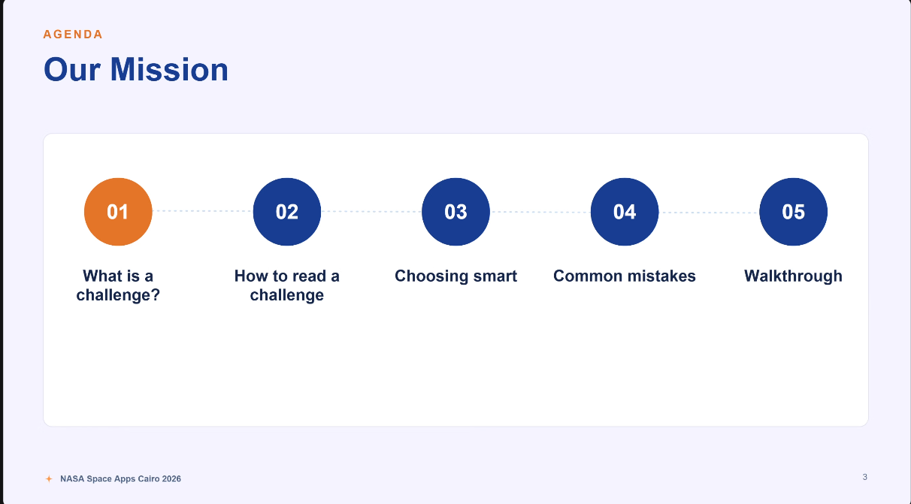 | Opening agenda — Our Mission |
| 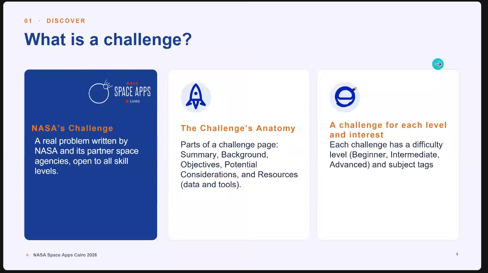 | What is a challenge? — definition and challenge-page anatomy |
| 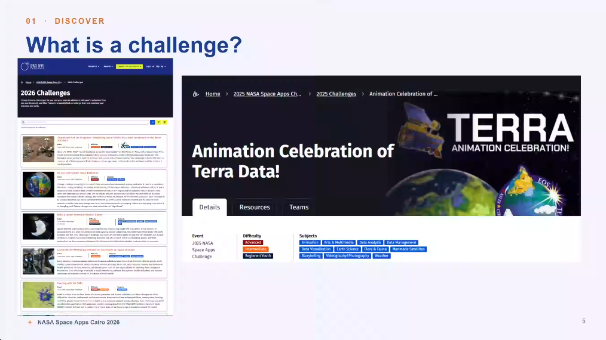 | Challenge list and example NASA Space Apps challenge page |
| 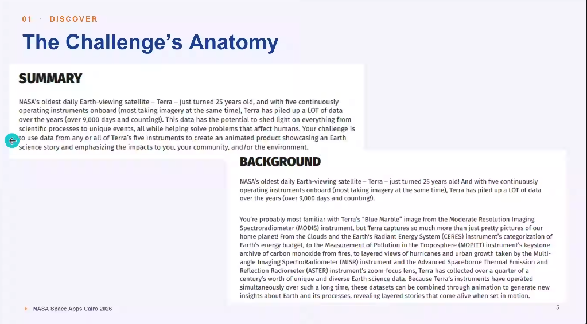 | Challenge anatomy — summary and background |
| 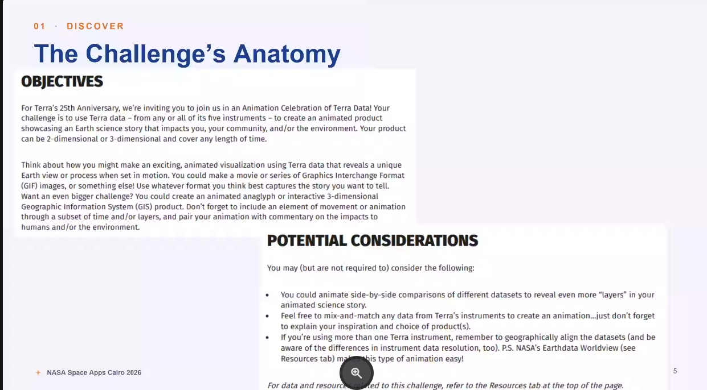 | Challenge objectives and potential considerations |
| 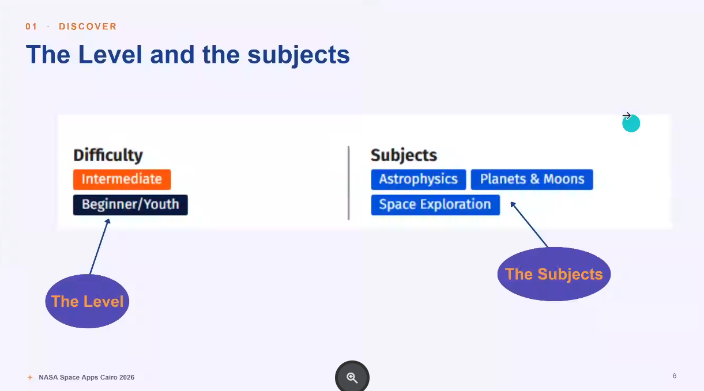 | Difficulty levels and subject tags |
| 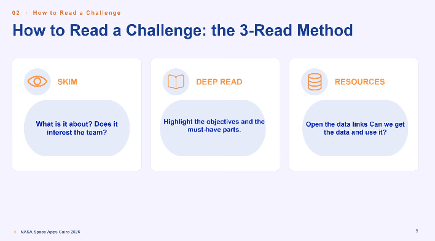 | The 3-read method |
| 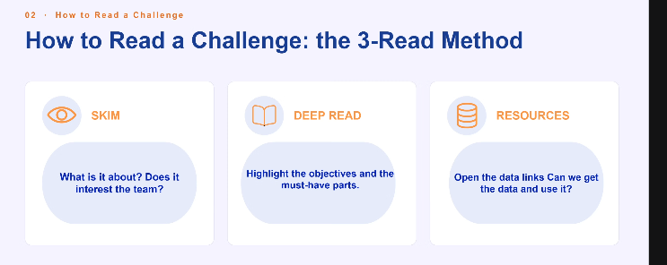 | Repeated capture of the 3-read method |
| 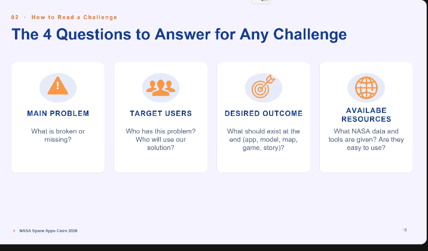 | The four questions to answer for any challenge |
| 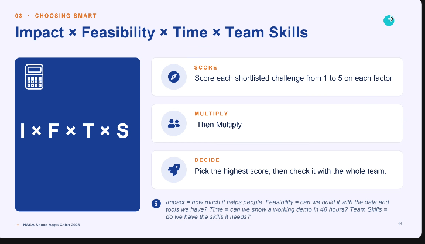 | Impact × Feasibility × Time × Team Skills |
| 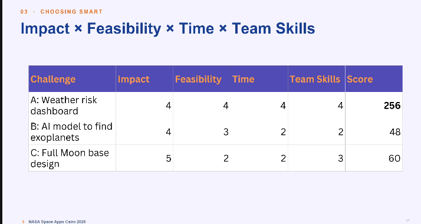 | Example challenge scoring table |
| 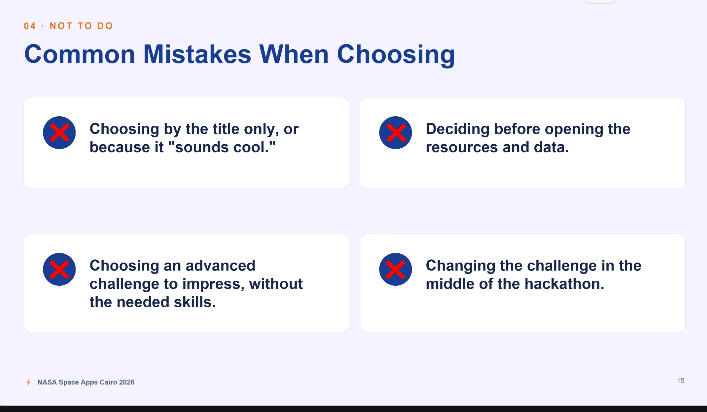 | Common mistakes when choosing a challenge |
| 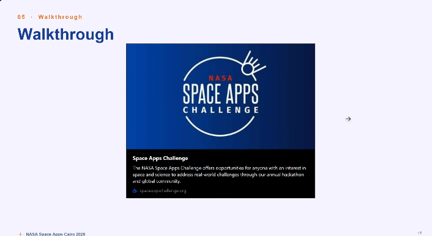 | Walkthrough |
| 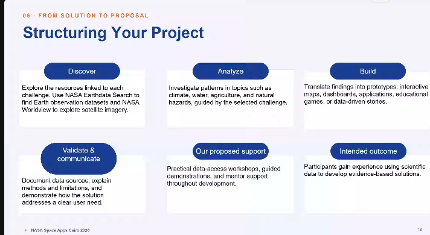 | Structuring your project |
| 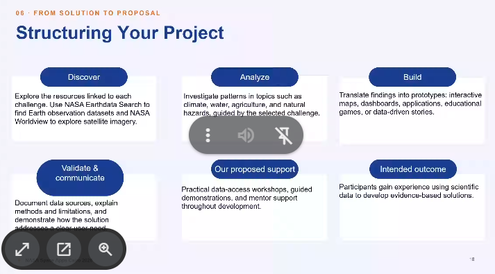 | Repeated capture of the project-structuring slide |
| 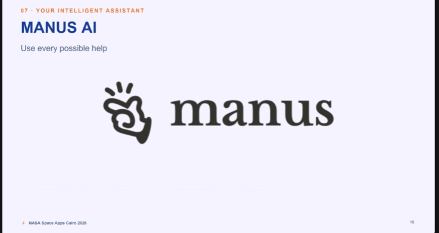 | Manus AI — Your Intelligent Assistant |

---

**Note:** This page records the content of one meeting session. It does not create or imply any team decision, technical architecture, backend requirement, repository requirement or official NASA rule.
