# NASA Space Apps Cairo 2026 — Mentorship & Discord Guide

A practical guide based on the mentorship presentation, Arabic session transcription, and Discord server walkthrough.

# Table of Contents

1. Introduction and Session Agenda
2. Understanding Mentorship
3. What Mentors Can and Cannot Do
4. The Mentorship Cycle
5. How to Ask Mentors for Help
6. Four Types of Mentoring Questions
7. Good Questions vs. Bad Questions
8. Conflicting Feedback and Common Mistakes
9. Discord: The Hackathon Communication Hub
10. Discord Server Structure
11. Understanding Each Discord Channel
12. How to Request Mentor Support
13. Understanding Discord Roles and Mentions
14. Which Channel Should I Use?
15. Discord Etiquette
16. Before and During the Hackathon Checklist
17. Final Recommendations

---

# 1. Introduction and Session Agenda

This session introduces participants to the mentorship system and the Discord server used during NASA Space Apps Cairo 2026.

The main objectives are:

- Understand the role of mentors during the hackathon.
- Learn how to ask mentors effective technical and project-related questions.
- Understand how to use Discord for communication and support.
- Learn how to request assistance through the support ticket system.
- Identify the correct channels for different types of questions and problems.

## Session Agenda

The session covers five main topics:

1. Understanding mentorship.
2. Accessing Discord.
3. Completing the registration form.
4. Introduction to Manus AI.
5. Questions and Answers (Q&A).

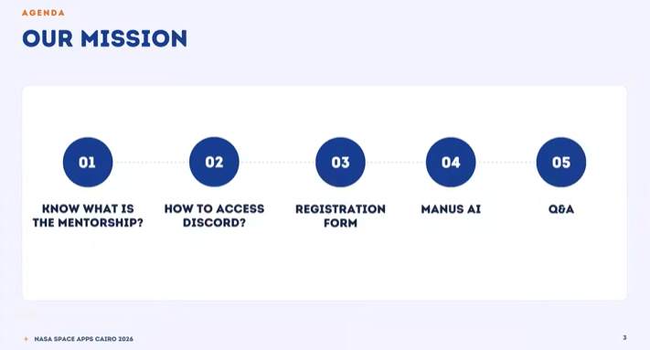

---

# PART I — UNDERSTANDING MENTORSHIP

# 2. What Is a Mentor?

A mentor is an experienced person who helps participants improve their ideas, make technical decisions, overcome problems, and develop stronger projects.

During NASA Space Apps, mentors provide guidance based on their professional and technical experience.

For example:

Imagine your team has an AI idea, but you are unsure whether it is realistic or whether you can implement it within the hackathon timeframe.

A mentor can help you evaluate the idea, refine its scope, and suggest a more suitable approach.

## 2.1 What Can Mentors Help You With?

Mentors can:

- Sharpen your project idea and scope.
- Help you make technical decisions.
- Guide you when you encounter technical difficulties.
- Review your project pitch and demo.
- Suggest suitable NASA datasets and resources.
- Recommend tools, models, or technologies.
- Help you identify weaknesses in your solution.
- Provide feedback to improve your final submission.

## 2.2 What Mentors Will NOT Do

Mentors will not:

- Build or code your project for you.
- Make the final decisions on your behalf.
- Fix problems without understanding what you have tried.
- Guarantee that your project will succeed.
- Take responsibility for implementing your solution.

**Important:** A mentor provides guidance, not a ready-made solution. You are responsible for understanding, implementing, and testing your project.

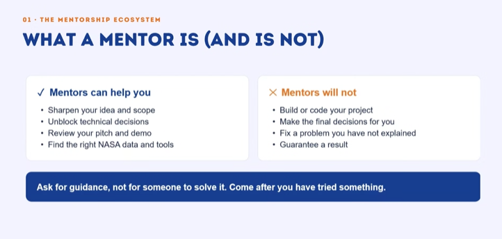

# 3. Why Should You Ask Mentors?

Mentors often have professional experience in different technical fields, companies, and industries.

You can benefit from their experience by asking for advice before spending too much time on an unsuitable approach.

For example:

Your team is developing a machine learning model, but you are unsure which dataset is most appropriate.

You can ask a mentor:

- Is this dataset suitable for our objective?
- Does the dataset contain enough information?
- Should we use another dataset?
- Is our current approach realistic within the available time?

The mentor can help you evaluate your choices, but your team must implement the solution.

## 3.1 NASA Resources and Datasets

The session emphasized the importance of using NASA resources and datasets in your projects.

Participants were encouraged to explore the official NASA Space Apps website and its Resources section.

The speaker mentioned November 13 as the expected date for resource availability during the session. Check official announcements for updates.

When choosing a dataset, consider:

- Relevance to your challenge.
- Dataset size.
- Data quality.
- Available features.
- Compatibility with your proposed solution.

---

# 4. The Mentorship Cycle: From Problem to Progress

The mentorship process consists of six steps.

### Step 1: Identify

Identify exactly what is blocking your progress.

Ask yourself:

- What is the problem?
- Where did the problem happen?
- What is preventing us from moving forward?

### Step 2: Prepare

Before contacting a mentor, prepare:

- What you have already tried.
- Relevant code or screenshots.
- Error messages.
- Results of previous experiments.

### Step 3: Ask

Ask a clear and specific question.

Avoid vague requests such as:

"Our AI model is not working. Can someone help?"

### Step 4: Evaluate

Understand the mentor's feedback and evaluate whether it fits your project requirements.

### Step 5: Decide

Discuss the recommendations with your team and decide which approach to implement.

### Step 6: Follow Up

Tell the mentor what you implemented and whether the recommendation worked.

This allows the mentor to understand your progress and provide more relevant advice if another problem appears.

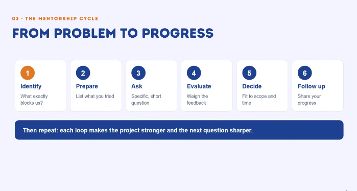

---

# 5. How to Ask a Mentor for Help: The Five-Part Structure

Before asking a mentor, prepare five important pieces of information.

| Part | Meaning | What to Explain |
|---|---|---|
| C — Context | What are you building? | Introduce your project and challenge. |
| G — Goal | What do you want to achieve? | Explain the objective. |
| T — Tried | What have you already done? | Mention your experiments and approaches. |
| P — Problem | What exactly is failing? | Explain the specific issue. |
| N — Need | What help do you need? | Ask for the guidance you are looking for. |

## 5.1 Example Message Template

Hi, we are Team [Team Name], building [Project Name] for [Challenge].

**Goal:** [What we want to achieve.]

**What we tried:** [Approaches, tools, models, or datasets we have already tested.]

**Problem:** [Explain the exact error or unexpected result.]

**What we need:** Could you advise us on [specific question or decision]?

We have attached screenshots or error messages for reference.

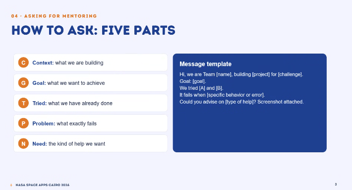

---

# 6. Four Types of Good Mentoring Questions

There are four main categories of questions you can ask mentors.

## 6.1 Direction Questions

These questions help you understand whether your project idea and scope are realistic.

Example:

"Is this project scope realistic for the available hackathon time?"

## 6.2 Technical Questions

These questions help you choose the appropriate technical approach.

Example:

"Which model architecture would be more suitable for our dataset size?"

## 6.3 Feedback Questions

These questions help you improve your project and final presentation.

Example:

"What is the weakest part of our demo?"

## 6.4 Decision Questions

These questions help you compare alternatives.

Example:

"We are choosing between Model A and Model B. Which approach would be more suitable for our users and why?"

**Important:** Ask open-ended questions that allow mentors to explain their reasoning. Avoid questions that can only be answered with yes or no.

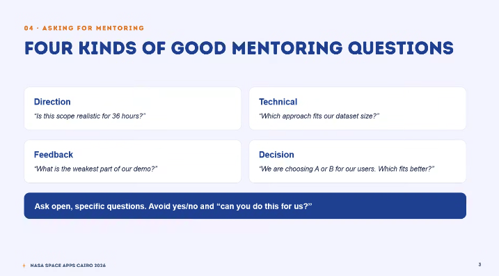

---

# 7. Good Questions vs. Bad Questions

The way you describe your problem determines how useful the mentor's answer will be.

## Bad Question

"Our AI model is not working. Can someone help us?"

Why is this a bad question?

- It does not explain the project.
- It does not explain the objective.
- It does not mention what you have tried.
- It does not identify the actual problem.

## Good Question

"Our goal is to classify wildfire smoke in satellite images.

We trained a pretrained CNN and applied data augmentation.

However, our validation loss starts increasing after a few epochs.

Could the problem be related to data imbalance or overfitting? Should we modify the dataset or try another model?"

Why is this better?

- It explains the project.
- It identifies the goal.
- It describes previous experiments.
- It explains the problem.
- It asks for specific technical guidance.

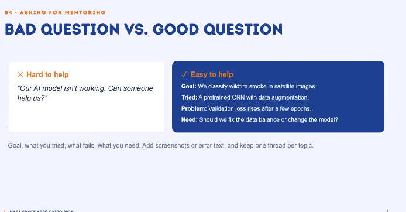

---

# 8. Conflicting Feedback and Common Mistakes

Sometimes different mentors may provide different recommendations.

This is normal because mentors may have different professional experiences and technical perspectives.

## 8.1 When Mentors Disagree

You should:

1. Ask each mentor to explain their reasoning.
2. Compare their suggestions.
3. Evaluate which approach better supports your project goal.
4. Consider the remaining time and available resources.
5. Discuss the alternatives with your team.
6. Decide which recommendation to implement.
7. Update the mentors about your decision if you meet them again.

Remember that mentors provide recommendations, but the final decision belongs to your team.

## 8.2 Common Mistakes

Avoid:

- Asking vague questions.
- Waiting until the last minute to request help.
- Expecting mentors to build your project.
- Implementing every suggestion without evaluating it.
- Losing useful advice in long conversations.
- Asking for help before trying to understand the problem.

Keep notes and organize your conversations by topic.

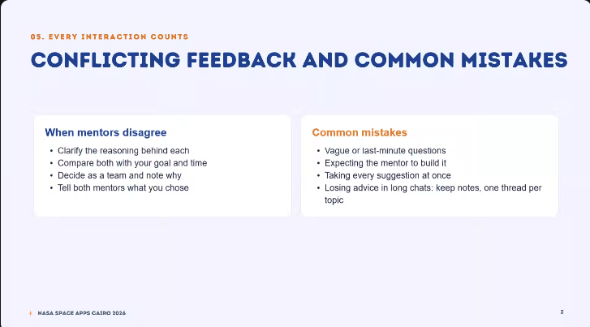

## 8.3 Practical Mentoring Tips

- Start working early.
- Record technical problems as soon as they appear.
- Prepare your questions before approaching mentors.
- Attach screenshots and error messages when relevant.
- Stay focused on the technical discussion.
- Apply the feedback and test the result.
- Follow up with mentors when you make progress.
- Ask for demo feedback before the final submission hours.

---

# PART II — DISCORD: THE HACKATHON COMMUNICATION HUB

# 9. Why Does NASA Space Apps Use Discord?

Discord is the main communication hub for NASA Space Apps Cairo 2026.

It allows participants to communicate with organizers, volunteers, mentors, and other teams.

The server is used to:

- Receive official announcements.
- Access important event information.
- Communicate with other participants.
- Ask questions.
- Request technical assistance.
- Connect with mentors.
- Report event-related problems.
- Follow track-specific discussions.
- Create private support tickets.

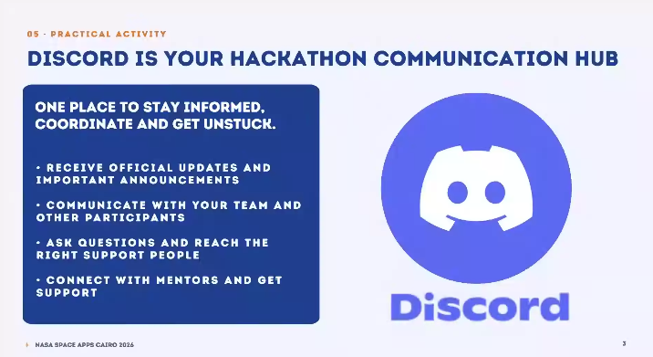

---

# 10. Understanding the Discord Server Structure

Discord servers are organized into categories.

Each category contains channels dedicated to a specific purpose.

The Discord interface generally contains:

- **Left sidebar:** Server categories and channels.
- **Middle section:** Messages and conversations.
- **Right sidebar:** Members currently in the server.
- **Bottom section:** Message input area.

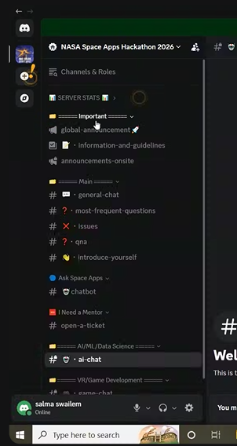

## 10.1 Server Categories and Their Purposes

The Discord server is organized into categories based on different purposes and technical tracks.

When participants first access the server, they are asked to choose the technical track they are interested in.

Based on their selection, they receive access to the corresponding track category and its channels.

**Important:** The available technical channels are not limited to AI/ML and VR/Game Development. The channels visible to each participant depend on the track they select when joining the server.

| Category | Purpose |
|---|---|
| Important | Official information and announcements. |
| Main | General communication between participants. |
| Ask Space Apps | Access to the event chatbot. |
| I Need a Mentor | Request direct support from mentors. |
| Technical Track Categories | Access to discussions and channels related to the participant's selected technical track. |

---

# 11. Understanding Each Discord Channel

## 11.1 Important Category

This category contains important event information.

### `global-announcement`

Purpose:

- Receive announcements for all participants.
- Follow important event updates.
- Check official instructions.

Participants should regularly check this channel.

### `information-and-guidelines`

Purpose:

- Understand event rules.
- Review participation guidelines.
- Find important instructions.

### `announcements-onsite`

Purpose:

- Receive announcements relevant to onsite participants.
- Follow onsite event updates and instructions.

---

## 11.2 Main Category

This category contains channels for general communication.

### `general-chat`

Purpose:

This is the main public conversation channel.

You can use it to:

- Communicate with other participants.
- Discuss general topics.
- Meet other teams.
- Ask general questions.
- Share information with the community.

Anyone with access to this channel can participate.

### `most-frequent-questions`

Purpose:

This channel contains frequently asked questions and their answers.

According to the session, repeated questions are collected periodically, approximately every one or two hours.

Before asking a question:

1. Open this channel.
2. Search for your question.
3. Read the available answers.
4. If your question is not answered, ask in the appropriate channel.

This prevents repeated questions and makes communication easier.

### `issues`

Purpose:

This channel is used for practical problems related to the event.

Examples:

- Internet connection problems.
- Electricity issues.
- Website access problems.
- Technical issues with event facilities.
- Problems accessing event resources.

### `qna`

Purpose:

This channel is for general questions about:

- NASA Space Apps.
- Event procedures.
- Registration.
- Teams.
- Schedules.
- General event information.

It is a place to ask questions that do not require specialized technical assistance.

### `introduce-yourself`

Purpose:

This channel allows participants to introduce themselves.

You can share:

- Your name.
- Your team name.
- Your technical track.
- Your interests.

It helps participants recognize each other and connect with other teams.

Example:

"Hi everyone! I'm Salma. I'm participating in the AI/Data Science track."

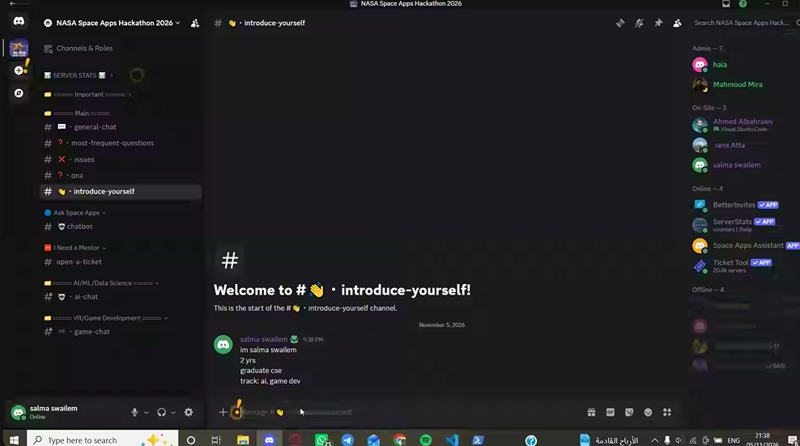

---

## 11.3 Ask Space Apps Category

### `chatbot`

Purpose:

This channel allows participants to interact with the NASA Space Apps Assistant.

You can ask general questions such as:

- What is NASA Space Apps?
- How can I submit my project?
- Where can I find information?
- What are the event procedures?

The session demonstrated the chatbot, but it returned a connection error during the live demonstration.

If the chatbot does not respond, use the appropriate Q&A channel or support route.

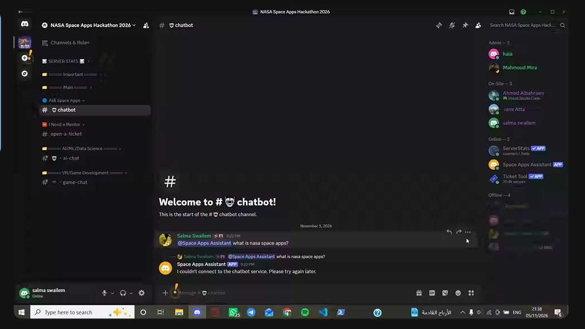

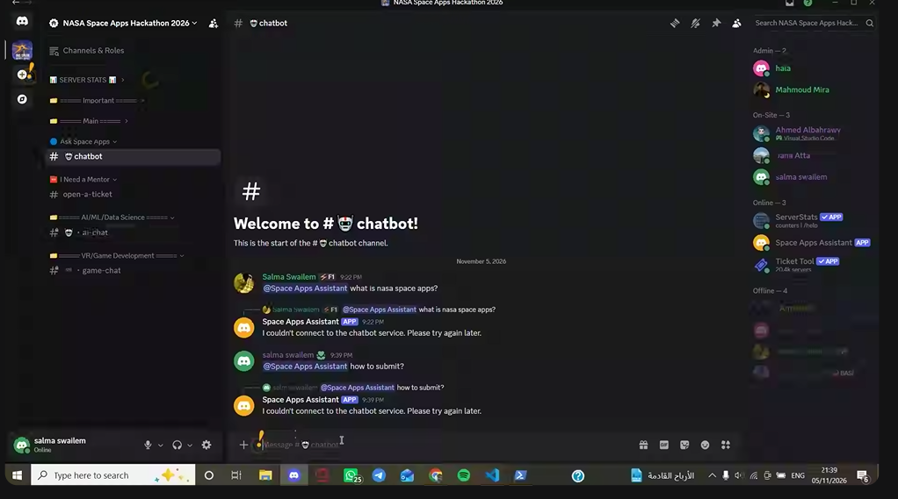

---

## 11.4 I Need a Mentor Category

This category is dedicated to requesting direct assistance.

### `open-a-ticket`

Purpose:

This channel allows participants to create private support tickets.

Use it when:

- You need direct mentor assistance.
- You have a technical problem that requires individual guidance.
- You need help with your project.
- You need assistance from the relevant technical track.

The ticket system is explained in detail in the next section.

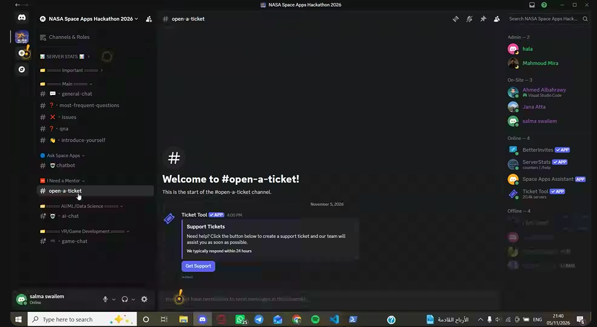

---

## 11.5 Technical Track Categories

When participants join the Discord server, they are asked to select the technical track they are interested in.

The server then provides access to the corresponding track category and its channels.

Each track has dedicated channels where participants can:

- Ask technical questions.
- Discuss problems related to their projects.
- Share ideas and technical knowledge.
- Communicate with other participants working in the same field.
- Exchange solutions and suggestions.

**The available track categories depend on the options provided by the organizers. Participants will not necessarily see every technical category in the server.**

### Examples of Technical Track Channels

The following are examples visible in the provided Discord screenshots:

#### AI/ML/Data Science

Channel: `ai-chat`

Purpose:

A public technical discussion channel for participants working in:

- Artificial Intelligence.
- Machine Learning.
- Data Science.

Participants can ask questions, discuss technical problems, and exchange ideas with others in the same track.

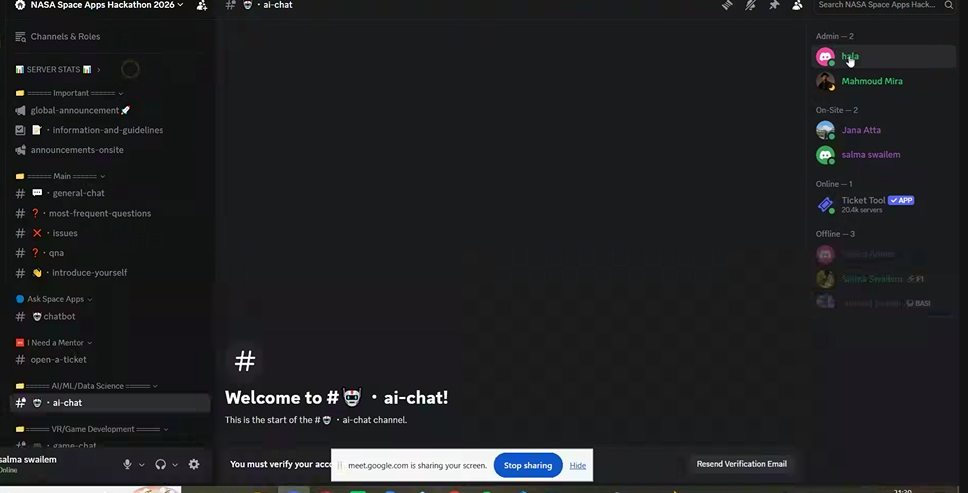

#### VR/Game Development

Channel: `game-chat`

Purpose:

A technical discussion channel for participants working in:

- Game Development.
- Virtual Reality.
- Game mechanics.
- Game development tools.

Participants can discuss technical challenges and exchange ideas related to their projects.

**Note:** These are examples, not the complete list of available tracks. Other technical categories and channels may be available depending on the participant's selected track.

---

# 12. How to Request Mentor Support Through Discord

This is one of the most important parts of the Discord walkthrough.

If you need individual assistance, follow these steps.

## Step 1: Open the `open-a-ticket` Channel

Go to the **I Need a Mentor** category.

Select:

`open-a-ticket`

You will find a support message containing a button called:

**Get Support**

## Step 2: Click Get Support

Click the button to open the support form.

## Step 3: Complete the Support Form

The form contains several fields.

| Field | Description |
|---|---|
| Team Name | Enter your registered team name. |
| Attendance Mode | Select Online or Onsite. |
| Building and Room Number | Enter your building and room if attending onsite. |
| Track | Select the technical track related to your issue. |
| What Do You Need Help With? | Describe your problem clearly. |

### Available Tracks Shown in the Demonstration

- Web Development.
- Mobile Development.
- AI/ML.
- GIS / Remote Sensing.
- VR / Game Development.

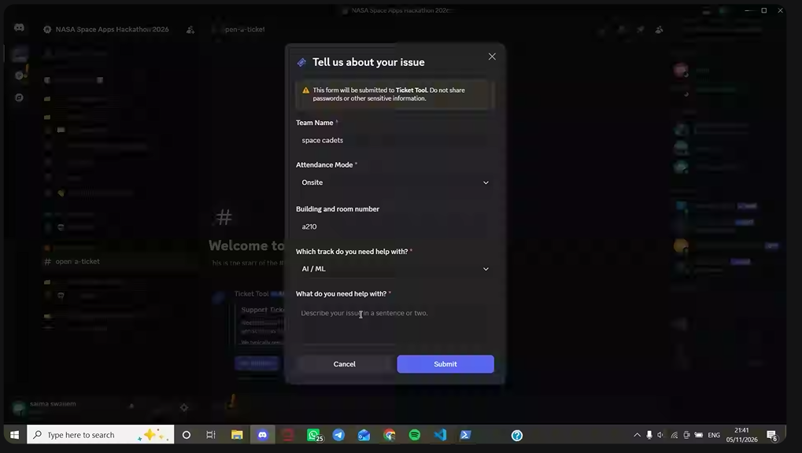

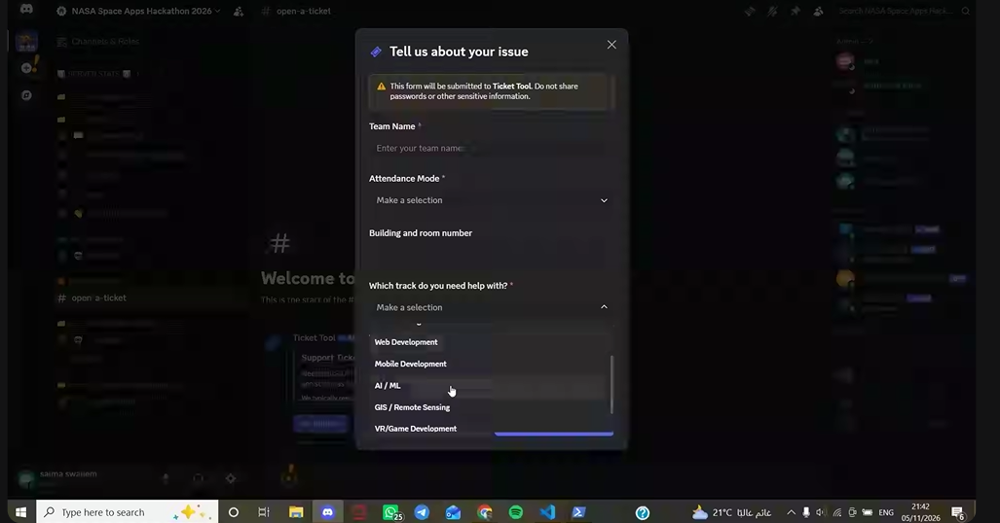

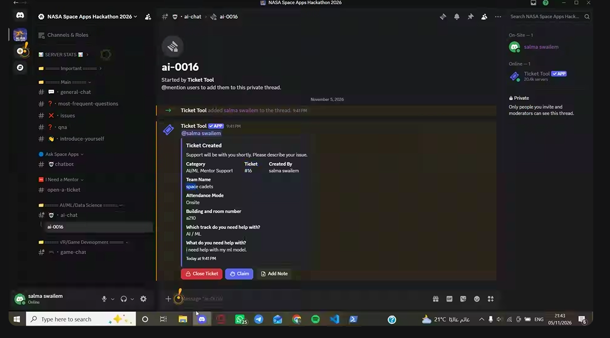

## Step 4: Submit the Form

After completing the form, click Submit.

Discord will create a new private ticket under the relevant track category.

For example, the demonstration created a ticket called:

`ai-0016`

The ticket contains your submitted information, including:

- Team name.
- Attendance mode.
- Building and room number.
- Selected track.
- Description of the problem.

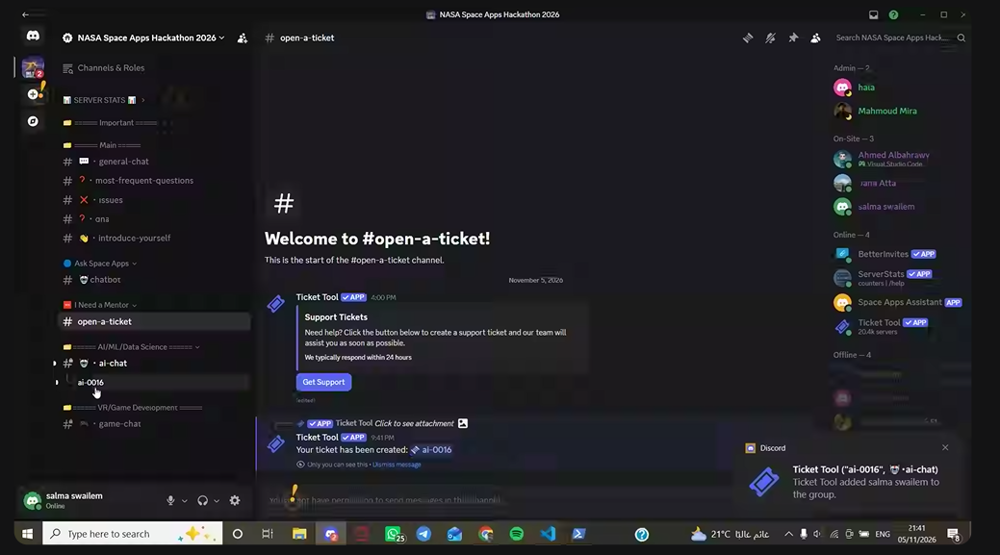

## Step 5: Communicate With the Mentor

After the ticket is created, wait for the assigned support person or mentor.

Explain your problem and provide any additional information needed.

You can:

- Describe the technical issue.
- Share relevant screenshots.
- Explain what you have already tried.
- Ask your specific question.
- Discuss possible solutions.

The ticket is private, so only authorized participants can access the conversation.

## Step 6: Understand Ticket Actions

The ticket interface includes several actions.

| Button | Purpose |
|---|---|
| Claim | A mentor or support person takes responsibility for handling the ticket. |
| Unclaim | Releases a previously claimed ticket. |
| Add Note | Allows a support-side note to be added. |
| Close Ticket | Closes the ticket when the issue is resolved. |

The demonstration showed a mentor claiming the ticket.

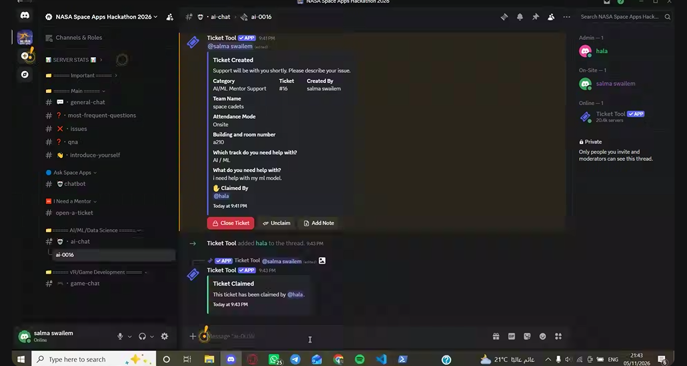

## Step 7: Close the Ticket

After your problem has been resolved, close the ticket.

Why?

1. To keep the active ticket area organized.
2. To avoid unnecessary open conversations.
3. To allow you to create another ticket when needed.

The session explained that closed ticket conversations remain available for later review and that ticket history can be downloaded.

**Important:** Close your existing ticket before opening another one if the system prevents multiple active tickets.

---

# 13. Understanding Discord Roles and Mentions

Discord roles identify participants according to their responsibilities or technical tracks.

For example:

- AI/ML participants.
- Game Development participants.
- Volunteers.
- Organizers.

## 13.1 What Is a Role Mention?

A role mention notifies members who have a particular role.

For example, if you mention a volunteer role, participants assigned that role may receive a notification.

Use mentions when you need to reach a specific group.

## 13.2 Important Notes

- Mention relevant roles only.
- Do not tag everyone unnecessarily.
- Use the correct technical channel.
- Remember that having a technical role does not necessarily mean someone is an assigned mentor.

---
# 14. Which Discord Channel Should I Use?

The correct channel depends on the type of question and, for technical questions, the track selected when joining the server.

| Situation | Correct Place |
|---|---|
| Cannot access a submission resource | `global-announcement` / relevant information channel |
| Registration or team issue | `qna` |
| Need clarification about a NASA challenge | Official challenge website / `qna` |
| AI or Machine Learning technical question | The technical channel corresponding to your selected track (e.g., `ai-chat`) |
| VR or Game Development question | The technical channel corresponding to your selected track (e.g., `game-chat`) |
| Question related to another technical field | The channel corresponding to your selected track |
| Need direct mentor assistance | `open-a-ticket` |
| Internet or electricity problem | `issues` |
| Website access problem | `issues` |
| General question | `general-chat` or `qna` |
| Want to introduce yourself | `introduce-yourself` |
| Want to ask the event chatbot | `chatbot` |
| Need feedback on your demo | Mentor support request |

**Important:** Always check the technical track you selected when joining Discord. Use the corresponding category and channels for technical discussions rather than assuming that every participant has access to the same technical channels.

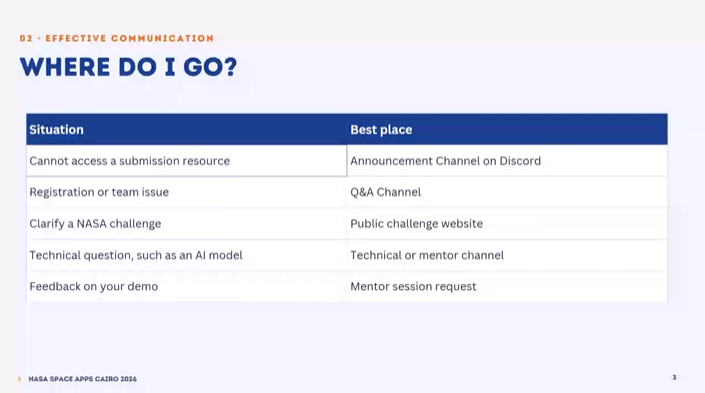

---

# 15. Discord Etiquette

To make communication effective:

- Read channel descriptions before posting.
- Check frequently asked questions first.
- Ask questions in the correct channel.
- Keep each discussion focused on one topic.
- Explain your problem clearly.
- Attach screenshots or error messages when relevant.
- Avoid unnecessary mentions.
- Never share passwords or sensitive information.
- Close resolved tickets.
- Update mentors when you make progress.

---

# PART III — HACKATHON PREPARATION

# 16. Before and During the Hackathon Checklist

## Before the Hackathon

- [ ] Complete the required registration form before the announced deadline.
- [ ] Check your email for event instructions.
- [ ] Join the official Discord server.
- [ ] Review the server categories.
- [ ] Select the correct role or track if required.
- [ ] Introduce yourself in `introduce-yourself`.
- [ ] Read `information-and-guidelines`.
- [ ] Review `most-frequent-questions`.
- [ ] Explore your NASA challenge.
- [ ] Check the available NASA resources.
- [ ] Make sure your team understands how to request mentor assistance.

## During the Hackathon

- [ ] Define a realistic project scope.
- [ ] Start implementing early.
- [ ] Use relevant NASA data and resources.
- [ ] Record technical problems.
- [ ] Try to solve problems before asking for help.
- [ ] Prepare questions using the five-part structure.
- [ ] Use the correct Discord channel.
- [ ] Request mentor support early.
- [ ] Evaluate mentor feedback as a team.
- [ ] Test the selected solutions.
- [ ] Ask for demo feedback before the final hours.
- [ ] Close resolved support tickets.

---

# 17. Final Recommendations

Remember these seven principles:

1. **Mentors guide; teams build and decide.**
2. Ask specific questions instead of vague ones.
3. Try to understand the problem before requesting assistance.
4. Use Discord as the main communication hub.
5. Always choose the correct channel for your question.
6. Request mentor assistance early instead of waiting until the deadline.
7. Follow up with mentors and close tickets after resolving problems.

---

# Source Notes

This guide was created using:

- NASA Space Apps Cairo 2026 mentorship presentation slides.
- Arabic transcription of the mentorship session.
- Discord server walkthrough screenshots.
- Demonstration of the support ticket creation and claiming process.

Some channel names were unclear in the audio transcription, so the visible Discord screenshots were used to identify them wherever possible.

Server layouts, procedures, and deadlines may change. Always follow the latest official announcements from the organizers.
